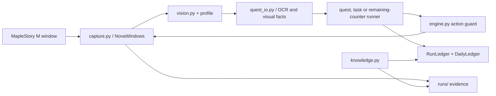

# Architecture

Mapleleaf is a local, Windows-only supervisor for a fixed set of MapleStory M activities. The current design keeps observation, interpretation, input authorization, durable attempt history and activity workflows in separate modules. The running game remains responsible for built-in Auto Battle; Mapleleaf does not provide a combat loop.

## Runtime boundaries

| Module | Responsibility |
|---|---|
| `capture.py`, `windows.py` | Attach to the installed Appium/NovaWindows driver, validate the native game window, capture client pixels and dispatch normal desktop input. |
| `vision.py`, `config/vision-*.json`, `anchors/` | Recognize known screens and reviewed visual anchors. Unknown or blocked screens remain non-actionable. Scores are image similarities, not confidence probabilities. |
| `observation.py`, `quest_io.py`, `text_facts.py`, `ui_facts.py` | Build observations, save frames and evidence, read configured OCR facts, and attach counter/ticket visual proofs. OCR text does not act as instructions. |
| `runner_base.py` | Shared foreground/identity/geometry checks, verified dispatch, preset proof, timeouts, interrupted-attempt handling and completion reconciliation. It has no default activity or entry workflow. |
| `quest_runner.py`, `mulung.py`, `dimension.py`, `task_status.py` | Activity-specific state machines and result checks. Elite keeps the public `QuestRunner` name; the other activities inherit the shared base directly. |
| `runners.py` | One explicit allowlist for dispatch and preflight. Resume-only Dimension is registered for recovery but excluded from daily entry validation. |
| `runner_cli.py`, `paths.py`, `results.py` | Single-quest command entry point, shared project root and interruption reports. `daily_runner.py` uses runtime modules directly rather than importing another CLI. |
| `daily_plan.py` | Validate plan structure, supported implementations, reset/config consistency and project-contained file paths before a game-control session is opened. `--validate` runs this preflight, loads vision profiles and counter templates, and exits without attaching to the game. |
| `remaining.py`, `daily_runner.py` | `CatalogueCounters` reads labelled entry counts; `RemainingSnapshot` caches them in memory only, with character/Home, age and reset-cycle checks. `daily_runner.py` reconciles those facts with the daily ledger and reports per-activity status. |
| `engine.py`, `daily_ledger.py` | Authorize actions, record intent before consequential input, prevent duplicate entry, and preserve uncertain attempts for reconciliation. A sent input is not proof of a transition or clear. |
| `knowledge.py`, `data/progress.sqlite` | Persist reviewed game facts and evidence references separately from transient observations and run history. Knowledge never substitutes for fresh state checks. |
| `dashboard.py` | Local observer UI. It captures, classifies and previews; it is not the daily execution interface. |

## Daily-runner logic

`daily_runner.py` processes enabled plan entries in order. For D02, D03, D07, D09 and D10 it requires a fresh, verified remaining-entry count before deciding status. The counter is the sum of the labelled free-entry and owned-ticket values; it is not task progress. D09 falls back to its labelled detail screen when the catalogue value is clipped. A blank, altered, ambiguous, clipped, wrong-screen or stale value is unknown and blocks the decision.

The live path checks the count before execution, refreshes it after a successful clear, and rechecks age/reset boundaries before reuse. `RemainingSnapshot` rejects a missing/naive/future timestamp, stale result, mismatched character or scan that did not return Home; callers receive a deep copy so report edits cannot change cached evidence. A verified zero may report the activity already complete only when the execution/ledger state permits that conclusion. Unresolved reservations and uncertain or running attempts remain stopped even if the ticket count is zero. A positive count that conflicts with a saved clear reports `not_done` and requires reconciliation; the once-per-cycle ledger still prevents a repeat entry. Counts are limited to the configured character and Dungeons reset scope. Configure a verified reset policy for each supported scope.

The `--validate` preflight checks plan/config/profile/template consistency without creating a driver session; it cannot establish current game state. The `--live` flag is consequential: with valid counts and an enabled taught workflow, the daily runner may send input. Without it, the runner sends no game input and cannot establish current completion. A report with missing definitions, unknown counts, or a stopped attempt is incomplete. Only explicit complete statuses for every selected activity yield `all_selected_completed=true`.

## Activity support and limits

| Activity | Implementation | Readiness |
|---|---|---|
| D02 Chaos | Remaining-count reader | No taught entry workflow; historical Star Force requirement may be stale. |
| D03 Elite | `elite-v1` | Supports guarded preparation and resume. Repeatable live entry and clear remain unverified. |
| D07/D08 bosses | Partial catalogue/count evidence | Exact targets, difficulty and intended one-shot skill are unresolved. No boss input is implemented. |
| D09 Dimension | `dimension-recovery-v1` | Resume-only for an unresolved ledger attempt. It cannot start an activity. Automatic party-to-battle transition and live recovery remain unverified. |
| D10 Mu Lung | `mulung-v1` | Supports preparation and result reconciliation. Repeatable live entry and clear remain unverified. Paid boosters are rejected. |
| D15 Tasks | `tasks-status-v1` | Reads six labelled counters and returns Home; no claims or Quick Move. Additional objectives need user choice. |
| D16/D17 | Evidence only | No activity workflow; objective scope needs user choice. |

Global Preset 1 must be freshly confirmed before each activity. Entry actions require a configured maximum owned ticket quantity for one run; buying tickets, paid boosters, automated claims/mail collection, revive inputs and external combat actions are disabled. Results and rewards awaiting manual claim are reported separately. The intended boss skill remains undefined. No recurring scheduler is running.

## Safety and evidence invariants

- Use the foreground MapleStory M client with the geometry specified by its vision profile. Stop on focus, window-identity, geometry or character mismatch.
- Check a fresh frame before input. A verified state transition is required after every dispatched action.
- Persist intent before entry or other consequential input. If the result is ambiguous, keep the reservation and reconcile; do not retry entry.
- Never infer zero from missing pixels, clipped geometry or OCR substitution. Ticket count, daily objective progress and reward claim state are separate facts.
- Do not automate Claim, Get All, mailbox collection, purchases, guild/event entry, boss skill or revive actions.
- Keep screenshots, OCR, decisions and results under `runs/`; tests may replay saved frames but do not establish current game state or live reliability.

## Local configuration

The observer and dashboard use `config/vision.json` and load image templates relative to the profile. The single-quest runner uses `quests/elite.json` by default and accepts another path through `--config`. The daily runner loads `config/daily-plan.json`, `config/remaining-catalogue.json` and `config/remaining-fields.json`. Keep all game captures, character settings and local ledgers in the ignored paths.
